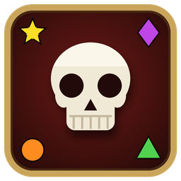

# BattleMarks

A raid-marker addon for **Azeroth Survivors** co-op (WoW 1.12.1 client, benilla).

When a co-op match loads, every hero in the party gets a raid marker, you included, so you can
find each other in the horde. Bosses get the skull, and the party is told who has what.

## Features

- **Markers for the whole party**: set when the match loads, and for anyone who joins later. You
  choose your own marker; teammates get the free ones in order. Markers you change by hand stay
  until the next match.
- **Skull and cross on bosses**: the top boss gets the skull and the second the cross (the final
  boss ranks first, then the others in the order they came). A third boss waits unmarked. When the
  skull boss dies the cross boss moves up to skull and the third gets the cross; when the cross
  boss dies the third gets the cross.
- **Guardians when no boss is up**: the awake guardians take skull and cross the same way, and give
  them up as soon as a boss appears. Elites are never marked.
- **Solo too**: boss and guardian markers also work when you play alone (a setting).
- 1.12 can only mark an enemy someone targets or hovers over, so a marker goes up as soon as anyone
  in the party targets that enemy. The game only tells a guardian from an elite for your own target,
  so a guardian is marked once you target it.
- **Choose which markers teammates get**: skull and cross are off by default (they're the bosses').
- **Party chat**: one line at the start, e.g.
  `Markers: Eric = Star, Bob = Circle. Skull = top boss, Cross = second.`
- **Plays well with itself**: if several heroes run BattleMarks, one of them sets the markers (the
  party leader, else the first by name) and everyone's chosen marker is honoured.
- Minimap button and a settings window.

## Install

1. Download `BattleMarks-vX.Y.Z.zip` from [Releases](../../releases/latest).
2. Put the `BattleMarks` folder into `benilla-config/AddOns/`.
3. Restart the game.

Or add this repository in [SurvivorsForge](https://github.com/Rezondes/SurvivorsForge) (*Add repo*)
to install and update it from there.

## Use

Left-click the skull on the minimap for the settings, right-click to turn BattleMarks on or off,
drag to move it.

| Command | Does |
|---|---|
| `/bmarks` | open or close the settings |
| `/bmarks me star` | your marker: star, circle, diamond, triangle, moon, square (or 1 to 6) |
| `/bmarks now` | set the markers right away |
| `/bmarks clear` | take every hero's marker off |
| `/bmarks on` / `off` | turn it on or off |
| `/bmarks status` | your settings, and who sets the markers in this party |
| `/bmarks button` | show or hide the minimap button |

## License

MIT. Azeroth Survivors is a fan game by Aethus. This addon is not affiliated with Blizzard
Entertainment.
